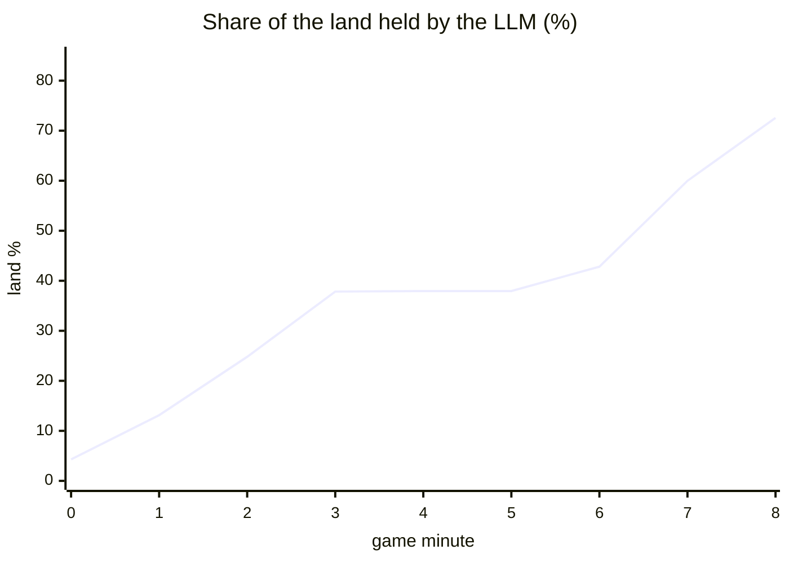
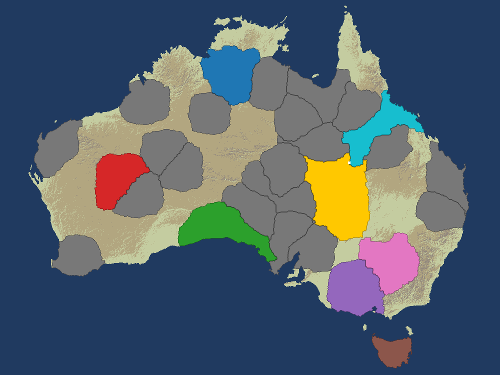
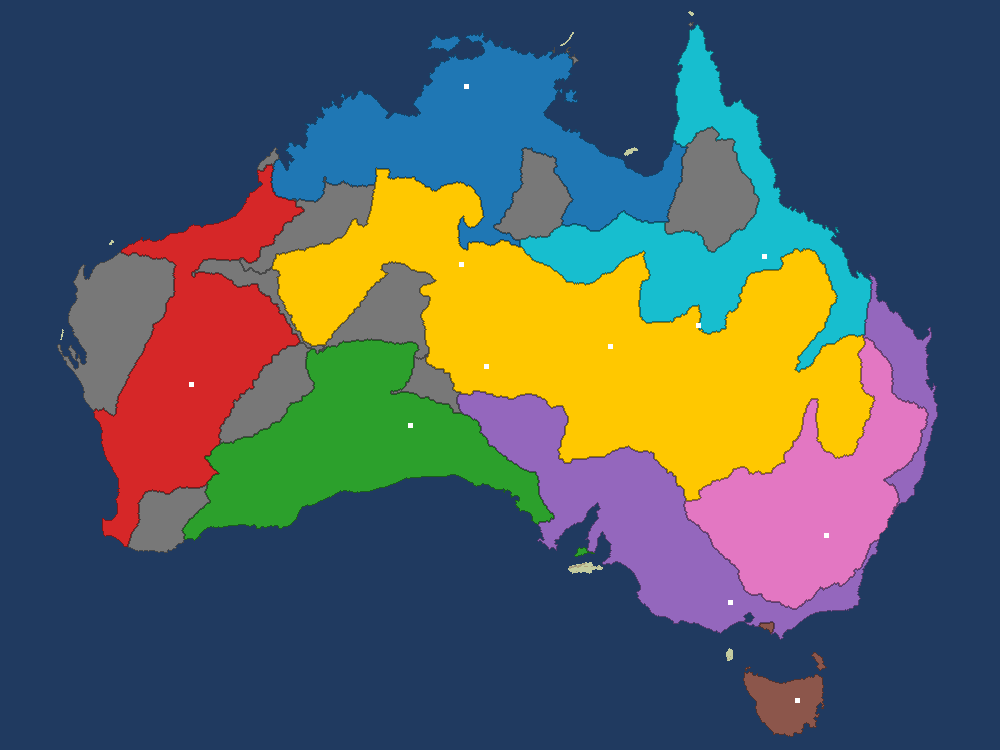
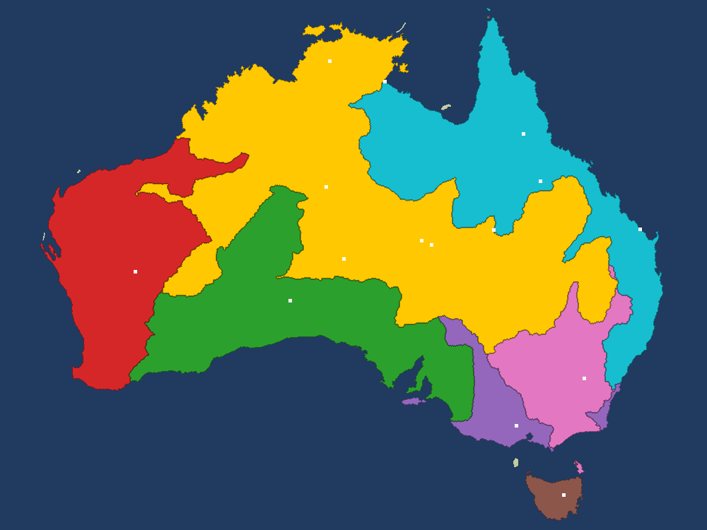
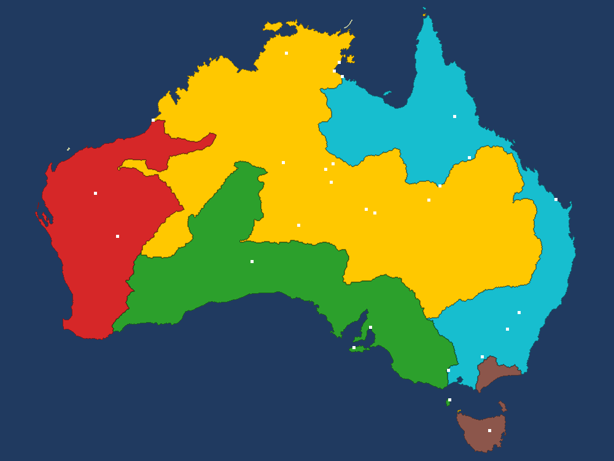
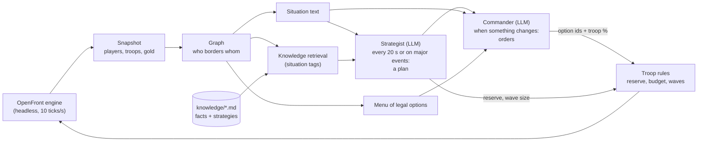

# LLM RTS: a local 9B language model plays a real-time strategy game, and wins


-7B61FF)


An agent that lets a **small local LLM (Qwen 3.5 9B, running in LM Studio on a laptop)** play [OpenFront](https://github.com/openfrontio/OpenFrontIO), a real-time strategy game, against the game's own AI. The model reads the game as a **graph**, draws on a **knowledge base** of tested rules, and plays through **two roles**: a strategist that plans and a commander that gives orders. The code enforces the plan between calls.

<p align="center">
  
  <br>
</p>

## Headline result

In a full match on the Australia map against 7 AI nations and 20 tribes (Easy difficulty, seed `australia-1`), **the LLM won the game outright after 8 min 49 s of game time, with 80.9% of the land.** It was ranked first from the first minute to the end.

| | |
|---|---|
| Outcome | **Won** (the game declared it the winner), rank 1 of 28 → 1 of 5 survivors |
| Land held | 4.3% at spawn → 37.8% at 3:00 → **80.9%** at 8:49 |
| LLM calls | 130 (29 strategist, 101 commander), **0 errors**, 8.0 s mean latency |
| Invalid orders | 0 possible: the model picks from a menu of legal options |
| Hardware | a single laptop, no cloud API (Macbook Air M5 24Go)|




| 1:00 | 3:00 | 5:00 | 7:00 |
|:---:|:---:|:---:|:---:|
|  |  |  |  |
| Spawns in the central plains, as the knowledge base advises | Has eaten the tribes around it, allied with neighbouring nations | Builds cities to raise its troop cap while the front is quiet | Its alliances expire; Victoria and New South Wales fall, Queensland is next |

## What this project demonstrates

| Skill | Where to look |
|---|---|
| **LLM agent design**: a planner/executor split, event-driven calls (the commander is only called when something changes), and a self-check that sends rule-breaking answers back once with the numbers | [src/agent/player.ts](src/agent/player.ts) |
| **Structured output and prompt engineering**: a JSON schema rebuilt every turn whose enum is the current list of legal options, with length limits so answers can never be cut off mid-JSON | [src/agent/prompts.ts](src/agent/prompts.ts), [src/llm/lmstudio.ts](src/llm/lmstudio.ts) |
| **Retrieval (RAG without embeddings)**: 37 knowledge sections, each tagged; the current situation picks the 6 that matter, deterministically. Every factual section is checked against the real engine by a test | [src/knowledge/kb.ts](src/knowledge/kb.ts), [knowledge/](knowledge/), [tests/knowledge.test.ts](tests/knowledge.test.ts) |
| **State abstraction**: 328,000 map tiles reduced to a graph of ~30 players (borders, attacks, alliances), then to a short text a 9B model can reason about | [src/state/graph.ts](src/state/graph.ts)|
| **Guardrails by construction**: the LLM chooses *what* to do from a menu of legal ids; the code chooses *where* and enforces a troop reserve and budget, so an invalid or suicidal order is impossible | [src/actions/menu.ts](src/actions/menu.ts)|
| **Integrating a large third-party codebase**: the unmodified OpenFront engine runs headless in-process, at a pinned commit, fetched with a sparse checkout (7 MB instead of 1.3 GB) | [src/engine/game.ts](src/engine/game.ts), [scripts/setup_openfront.sh](scripts/setup_openfront.sh) |
| **Evaluation and experiments**: scripted baselines on the same seed, ablations, and offline reproductions of failures without the LLM | [notebooks/08_baselines.ts](notebooks/08_baselines.ts)|
| **Observability and reproducibility**: every prompt, answer, order and state is logged to `turns.jsonl`; a match replays exactly from its records | [src/match.ts](src/match.ts), [src/report.ts](src/report.ts),  |
| **Testing**: 39 Vitest tests covering the engine, graph, menu, knowledge facts, LLM client, player and a full match with a mock LLM (a 30-minute game runs in seconds) | [tests/](tests/), [src/llm/mock.ts](src/llm/mock.ts) |


## How it works



1. **Engine**: the real OpenFront simulation runs in-process, through the same calls the browser uses. Game time pauses while the model thinks, so a slow local model is not penalised.
2. **Observation**: the full state is reduced to what a player needs, and "what changed since last time" becomes sentences ("Queensland started attacking you with 46,040 troops").
3. **Graph**: territory becomes a graph of players, then a situation text with unambiguous wording ("WEAKER than you").
4. **Knowledge**: the strategist gets the core rules plus the 6 most relevant sections for the situation, and must cite the ones it used.
5. **Two roles**: the strategist writes a plan (priorities, a focus, the troop reserve to keep, the size of expansion waves). The commander turns it into at most two orders, as JSON validated against the schema.
6. **Troop rules**: the code relaunches expansion waves and keeps the reserve and a budget per 5 s, whatever the model asks.

A real commander turn from the winning match, at 3:15:

```json
{
  "reason": "Carolinian Republic eliminated; attack Carolinian Commonwealth to secure west, then build city for growth. Keep 35% reserve (682,942 troops) and stay under 55% current (839,243 troops) limit.",
  "actions": [
    { "id": "attack_carolinian_commonwealth", "troops_percent": 30 },
    { "id": "build_city", "troops_percent": 0 }
  ]
}
```

## How it got there: iterating from the logs

The first versions lost. Each failure was diagnosed by reading `turns.jsonl`, fixed in the interface or the code, and re-tested on the same seed:

| Version | Setting | Result |
|---|---|---|
| First test games (v1-v3) | Medium, 5 s turns | Good openings (up to 9.3% of the land), then a collapse |
| Strategist + commander, the LLM controls every troop | Medium, 5 s turns | Peak 10.2%, **eliminated at 3:50** |
| Same model, the code enforces the plan's reserve and waves | Medium, 1 s turns, 3-minute test | **24.1% of the land, rank 1 of 11** at 3:00 |
| Same agent, full game | Easy, 5 s turns | **Won at 8:49 with 80.9%** |

For comparison, scripted players on the same seed at Medium peaked at 5.8% of the land and were eliminated by 6:21.

A few examples of fixs:

- **"Send troops to defend."** The model kept attacking a stronger nation "to defend", draining its army from 111,000 to 27,000 troops. In OpenFront, troops kept at home *are* the defence. → A core rule says so, and each attack option shows the strength comparison right next to its id.
- **Faster is not more reactive.** A 1-second cadence repeated "expand 30%" every second and drained the army in 10 s. A script with no LLM reproduced the collapse. → A troop budget per 5 s of game time and a reserve chosen by the plan; the same cadence then went from eliminated to first place.
- **A cut-off answer.** A free-text field grew until the token limit, and the JSON never closed. → `maxLength` on every text field in the schema, enforced by LM Studio while decoding.
- **An invented price.** A plan claimed a city costs 10,000 gold (it costs 125,000). → Prices moved into the core rules that every prompt sees.

The main takeaway: **most of the improvement came from the interface (wording, menu, schema, troop rules), not from the model.** The model chooses goals and numbers; the code applies them reliably.

## Limitations and next steps

- The winning match was on **Easy**; at Medium, longer games have not yet been run with the final agent.
- One seed. Running several seeds, and ablations (knowledge base off, troop rules off), would measure what each part is worth. Each is a config change away.
- The self-check doubles some commander calls; making the allowed troop share more visible could save most of them.
- Qwen 3.5 reads images: giving it the rendered map is an obvious next experiment.

## Quick start

Requirements: Node.js 24, git, and [LM Studio](https://lmstudio.ai) with `qwen/qwen3.5-9b` downloaded and its server started.

```bash
npm install
npm run setup       # fetch the OpenFront engine and the Australia map (~7 MB) at the pinned commit
npm test            # 39 tests, no LLM needed
npm run check-llm   # check that LM Studio answers
npm run play        # play one match with config/match.json
```

`play` prints one line per turn and writes everything to `runs/<date>-<seed>/`: `report.md`, `turns.jsonl` (every prompt and answer), `summary.json` and map images.

Options: `--seed <text>`, `--minutes <n>`, `--model <LM Studio id>`, `--bots <n>`, `--difficulty Easy|Medium|Hard|Impossible`, `--size Normal`, and `--mock` to run the whole pipeline without an LLM.

## Repository layout

```
src/
  engine/game.ts      the OpenFront game, headless (create, submit orders, advance)
  state/observe.ts    snapshot of the state from the LLM player's side
  state/graph.ts      the player graph and the situation text
  state/render.ts     map as PNG and as text
  actions/menu.ts     legal options, chosen sites, translation to engine orders
  knowledge/kb.ts     knowledge base loading and retrieval
  llm/lmstudio.ts     LM Studio client (JSON schema output); llm/mock.ts for tests
  agent/              events, prompts, the two-role LLM player
  match.ts, report.ts the match loop and its report
  cli/                npm run play, npm run check-llm
knowledge/            the knowledge base (Markdown)
tests/                39 tests: engine, graph, menu, knowledge facts, LLM client, player, full match
docs/                 the report and maps of the winning match
config/               match settings, pinned OpenFront commit
```

## License and credits

AGPL-3.0 ([LICENSE](LICENSE)), because the project runs the OpenFront engine in its own process. The engine ([OpenFrontIO](https://github.com/openfrontio/OpenFrontIO), © OpenFront and contributors, AGPL-3.0) is downloaded at setup and not redistributed here; its maps are CC BY-SA 4.0 ("OpenFront"). This is an independent project, not affiliated with OpenFront.


## Acknowledgment
The development of this project was assisted by Claude Code.